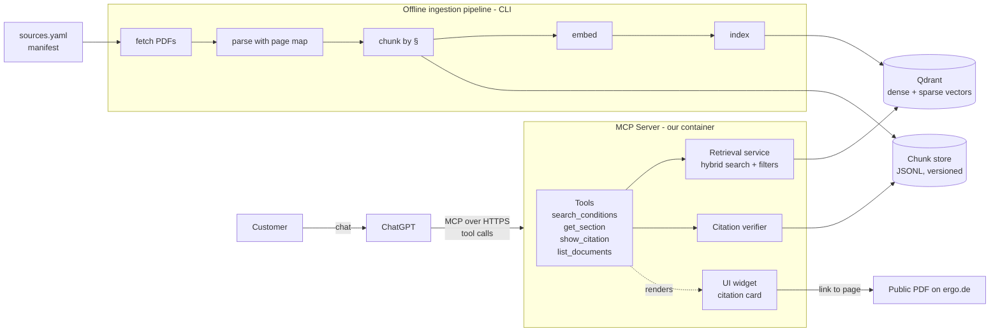
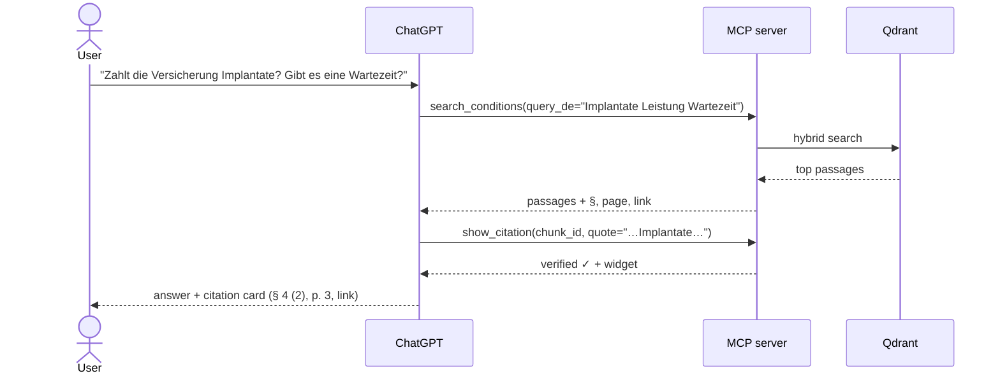

# Architecture — ERGO Dental Insurance ChatGPT Plugin (PoC)

Status: draft v0.1 (WBS 1.4) · Scope: demo on **public** ERGO DE dental documents only

## 1. Goal

A customer asks ChatGPT a question about their dental insurance ("Does my tariff cover implants?",
"Is there a waiting period?"). ChatGPT answers **and proves the answer** by quoting the exact passage of
the official terms & conditions, with document name, section (§) and page, and a link to the PDF page.

**Demo scope:** the PoC is framed as "dental", but the demo uses only **publicly available ERGO terms &
conditions** to prove the mechanism (retrieve → answer → verified citation). The pipeline is
document-agnostic; swapping in other documents is a manifest change, not a code change.
**Languages:** customers can write in **English or German**; answers come back in the user's language,
quotes are always shown in the original German with an English translation when the user writes English.
**Hosting:** private resources, demo only. If the PoC is approved, hosting, embeddings and access
control move under the ERGO umbrella; the design keeps those pieces swappable.

Later phases (already in the WBS, not part of the first demo) add tariff catalogue, needs-to-option
matching, illustrative premium calculation, an embedded configurator, adviser handoff and an admin panel.
The architecture leaves seams for them but does not build them yet.

## 2. Key design decisions

| # | Decision | Why |
| --- | --- | --- |
| D1 | Build a **ChatGPT plugin** = **MCP server** (tools) + **skills** (workflow/conversation instructions around the tools) + optional **UI** (MCP Apps widgets). | Current OpenAI model ("apps" were renamed to "plugins" in 2026; unrelated to the 2023 plugins retired in 2024). The MCP server and UI follow open standards (MCP / MCP Apps), so the same server also works with other MCP clients (Claude, Copilot Studio, etc.). |
| D2 | **ChatGPT is the LLM. Our server does not generate answers.** It retrieves and returns source passages; ChatGPT writes the reply. | No LLM API key or prompt-hosting on our side; less cost, less risk. Our job is *retrieval quality and verifiable citations*. |
| D3 | Citations are **verified by the server**, not trusted from the model. The model passes the quote it wants to show; the server checks it exists verbatim in the source chunk and renders it. | This is the "prove the point" requirement. A model can paraphrase or hallucinate a quote; the server-rendered citation card cannot. |
| D4 | **Hybrid retrieval** (dense embeddings + BM25 keyword) over **section-aware chunks** (one chunk ≈ one § / sub-clause). | Insurance T&Cs are full of exact terms (*Wartezeit*, *Implantate*, *Inlays*, § numbers) where keyword search beats pure vectors; § boundaries make citations meaningful. |
| D5 | Python, official `mcp` SDK 2.x (`MCPServer`, formerly FastMCP), Streamable HTTP transport, single container. | Matches the repo template; one deployable unit for the demo. |
| D6 | Vector store: **Qdrant** (embedded/local mode for dev, Docker or Qdrant Cloud for hosted demo). | Native dense + sparse hybrid search, metadata filters, trivial to run locally, scales if PoC continues. Alternatives considered: Chroma (no built-in hybrid), pgvector (needs Postgres), LanceDB (fine, less mature hybrid). |
| D7 | Embeddings: **multilingual local model** via `fastembed` (`intfloat/multilingual-e5-base` for the demo; `-large` if eval shows it helps), behind an `Embedder` interface. | Documents are German, customers ask in English or German — a multilingual model matches across languages. Local = no API key, no data leaves the box. Swappable later for an ERGO-approved service (e.g. Azure OpenAI in EU). |
| D9 | Demo hosting: **local + HTTPS tunnel** for development, then **one small EU VM** (e.g. Hetzner CX22, 4 GB RAM, ~€5/month) running Docker Compose + Caddy (automatic HTTPS). Qdrant runs embedded inside the server process — one container. | Cheapest always-on option that fits a local embedding model in memory, no cold starts (ChatGPT tool calls time out on slow cold starts of serverless hosts), EU/Germany location reads well for ERGO. Throwaway: if approved, re-deploy the same image on ERGO infrastructure. |
| D8 | The knowledge base is **built offline and versioned in git** (source manifest + chunk files). The index is a build artifact. | WBS 2.2 "versioned knowledge files with section-level references"; reproducible; every citation traces back to a document version + hash. |

## 3. System overview



## 4. Components

### 4.1 Ingestion pipeline (offline CLI) — WBS 2.1, 2.2

`python -m insurance_gpt.ingest build`

1. **Manifest** `knowledge/sources.yaml` — one entry per document:
   `doc_id`, title, product/tariff(s), source URL, version/edition date, retrieval date, `sha256`, language.
   Only public documents in the demo; each labelled as such.
2. **Fetch** — use `knowledge/raw/<doc_id>.pdf` (committed), downloading it only if missing; verify the hash (fail if the document changed silently).
3. **Parse** — `pymupdf` / `pymupdf4llm` to text with a **page map** (char offset → page number) and
   heading detection. (Fallback: `docling` if tables/layout parse badly.)
4. **Chunk** — split along the document's own structure: `§ 4 Umfang der Leistungspflicht → (2) → a)`.
   Each chunk keeps: `chunk_id`, `doc_id`, `section_path` (e.g. `§4 (2) a`), `section_title`,
   `page_start/page_end`, verbatim `text`, plus a short "context header" (doc + section title) prepended
   *for embedding only*. Oversized sections are split with overlap; tiny ones merged with siblings.
5. **Embed + index** — dense (multilingual-e5) + sparse (BM25) vectors into Qdrant, payload = metadata.
6. **Write** `knowledge/chunks/<doc_id>.jsonl` (committed; human-reviewable diff when a document changes).

### 4.2 Retrieval service — WBS 3.3

- Hybrid query (dense + sparse, fused with RRF), optional filter by `doc_id` / tariff.
- Optional reranker (e.g. `bge-reranker-v2-m3`) — add only if the eval set shows it's needed.
- **Relevance threshold**: below it, return `status: "no_relevant_passage"` instead of weak hits, so the
  model says "the conditions don't cover this" rather than stretching an unrelated clause.
- Query language: tool schema asks the model to send the query **in German** (the documents' language)
  and optionally the original question; dense multilingual embeddings cover the rest.

### 4.3 MCP server and tools — WBS 3.2, 4.1, 4.5, 4.6

All tools are read-only (`readOnlyHint: true`) and return `structuredContent` (data for the model/widget)
plus a short text `content`.

| Tool | Input | Output | Purpose |
| --- | --- | --- | --- |
| `list_documents` | – | covered products/tariffs, documents, editions | Lets the model know the scope; basis for out-of-scope answers (4.6). |
| `search_conditions` | `query_de`, `question?`, `tariff?`, `top_k` | ranked passages: `chunk_id`, text, doc title, `section_path`, pages, score, PDF deep link | Main RAG tool. |
| `get_section` | `doc_id`, `section_path` | full section text + neighbours | Lets the model read the whole § when a hit is a fragment (exclusions often sit in the next sub-clause). |
| `show_citation` | `chunk_id`, `quote` | verified quote + metadata, **renders citation widget** | The "proof". Server checks `quote` is a (whitespace/hyphenation-normalised) substring of the chunk; if not, returns an error telling the model to quote exactly. |

Errors are returned as structured, recoverable messages for the model (4.5): `no_relevant_passage`,
`unknown_tariff`, `quote_not_found`, `service_unavailable`.

**Conversation guidance (4.1)** lives in the plugin's **skill** (packaged with the plugin, `plugin/skills/`) plus
tool descriptions and server instructions as a fallback for MCP-only clients, e.g.:
answer only from returned passages; always call `show_citation` for the key claim; quote in German and
translate if the user writes in English; say when the documents don't answer the question; never give a
binding coverage decision — add the "informational only, the contract is decisive" disclaimer;
offer the adviser handoff for anything personal (claims, own contract).

### 4.4 UI widget (citation card) — WBS 5.2

A small static HTML/JS bundle served as an MCP Apps UI resource (`ui://widget/citation.html`), linked from
`show_citation`. It shows: document title + edition, `§` path, page, the quoted text highlighted within
its surrounding paragraph, and an "Open PDF at page N" link (`<url>#page=N`). It renders only
server-provided data, so the user sees the real source text.

> Per OpenAI's plugin UI docs: tool links to the widget with `_meta.ui.resourceUri` (ChatGPT also accepts
> the alias `_meta["openai/outputTemplate"]`); resource MIME type `text/html;profile=mcp-app`; resource
> `_meta.ui.csp` declares allowed domains (we need `frameDomains`/`resourceDomains` only if the widget
> embeds the PDF; a plain link needs none). The widget talks to ChatGPT over the standard `ui/*` bridge;
> `window.openai` extras only behind feature detection. Our split — data tools (`search_conditions`)
> without UI, a separate render tool (`show_citation`) with UI — is the pattern OpenAI recommends.
> URIs are cache keys: version them (`ui://citation/v1.html`).

The later **tariff configurator** (4.2/4.3) is a second widget on the same mechanism.

### 4.5 Request flow (happy path)



## 5. Future modules (seams only)

Kept as separate packages behind the same MCP server so they don't entangle the RAG demo:

- `tariffs/` — machine-readable tariff catalogue (YAML/JSON from WBS 2.1), combination validation (3.4),
  needs-to-option matching with reasons (3.5), illustrative premium calculation (3.6). **Deterministic
  Python, never the LLM**, unit-tested against reference cases (6.1).
- `handoff/` — simulated adviser link (4.4), no real lead created.
- `admin/` — admin panel for marketing users to edit tariff/knowledge content (4.7); would write to the
  same manifest/catalogue and trigger a re-index.

## 6. Repository layout

```text
src/insurance_gpt/
  server.py            # MCPServer app, tool + widget registration, /mcp endpoint
  config.py            # pydantic-settings, env vars
  tools/knowledge.py   # list_documents, search_conditions, get_section, show_citation
  retrieval/           # embedder interface, qdrant store, hybrid search, citation verifier
  ingest/              # fetch, parse, chunk, build (CLI)
  widgets/citation/    # widget HTML/JS
plugin/
  skills/              # ChatGPT plugin skill(s): conversation guidance, citation rules (WBS 4.1)
knowledge/
  sources.yaml         # document manifest (versioned)
  raw/                 # source PDFs, <doc_id>.pdf (committed)
  chunks/*.jsonl       # versioned chunks with section/page references
tests/
  unit/                # chunker, verifier, retrieval
  eval/questions.yaml  # golden Q&A: question → expected doc + § (from WBS 1.2 scenarios)
docs/
Dockerfile, pyproject.toml (uv), .env.example
```

## 7. Tech stack

| Concern | Choice |
| --- | --- |
| Language / packaging | Python 3.12, `uv` |
| MCP | `mcp` 2.x (official SDK, `MCPServer`), Streamable HTTP |
| PDF parsing | `pymupdf` / `pymupdf4llm` (fallback `docling`) |
| Embeddings | `fastembed` — `multilingual-e5-base` dense + BM25 sparse |
| Vector DB | Qdrant (`qdrant-client`, embedded local mode, on-disk) |
| Config | `pydantic-settings`, `.env` |
| Tests | `pytest`; retrieval eval script (recall@k, correct-§ rate) |
| Dev tooling | MCP Inspector; `ngrok` / `cloudflared` tunnel to test in ChatGPT |
| Deploy | Docker image + Compose; Caddy reverse proxy for HTTPS; small EU VM (demo) |

## 8. Environments

1. **Local dev** — server on `localhost:8000/mcp`, Qdrant embedded, tested with MCP Inspector.
2. **ChatGPT dev** — same server through an HTTPS tunnel (`ngrok` free static domain or a
   Cloudflare named tunnel — a *stable* URL matters, otherwise the plugin must be re-registered each time).
   Register it at chatgpt.com/plugins → **+** → *Add custom MCP server* → *Create as a plugin*, install it
   from personal plugins, then use it in a **Work** chat via `@`. (Check which ChatGPT plans allow custom
   MCP servers.) Enough for working sessions; only runs while the dev machine is on.
   Packaging the skill with the server and submitting to the directory is a later step (WBS 5.2).
3. **Hosted demo** (WBS 5.1) — the same image on a small EU VM with Docker Compose + Caddy, a domain or
   subdomain pointing at it (Caddy gets the Let's Encrypt certificate). The index is built at image build
   time from the committed chunks, so a deploy is `git pull && docker compose up -d --build`.
   Always on, so stakeholders can try it without the dev machine.
4. **After approval** — out of scope here: ERGO hosting, identity (OAuth/SSO), approved embedding service,
   managed vector DB. The container, the `Embedder` interface and the Qdrant client are the swap points.

## 9. Security and compliance (demo level) — WBS 5.3, 6.3

- Public documents only; no customer data, no ERGO internal systems.
- Server is read-only and stateless; no conversation storage. Logs record tool name, query, latency,
  result ids — with a redaction filter for emails/phone numbers/policy numbers in queries.
- Access: unauthenticated URL is acceptable only for a short-lived internal demo. Before sharing wider,
  add OAuth (supported for custom MCP servers) or at minimum an allow-listed gateway.
- Prompt injection: document content is curated and versioned (low risk); tool outputs are data, the
  server never executes instructions from queries. Covered by eval cases (6.3).
- Every answer carries the "informational, not a binding coverage decision" disclaimer.

## 10. Quality and evaluation — WBS 1.2, 6.1–6.3

- Golden set of ~30–50 questions built from WBS 1.2 scenarios: happy paths, edge cases (exclusions,
  waiting periods, caps in first years), out-of-scope (car insurance, own claim status), adversarial.
- Automated: retrieval recall@5 for expected §, citation-verifier unit tests, chunker tests on real PDFs.
- Manual: run the scripted demo in ChatGPT and check answer + citation for each scenario.

## 11. Decisions log and open questions

Decided (2026-11-05):

- Demo content: public ERGO terms & conditions only; pipeline stays document-agnostic.
- Languages: English and German (questions and answers); quotes shown in original German.
- Hosting: private resources, tunnel for dev → small EU VM for the hosted demo (D9).
- Embeddings: local multilingual model for the demo; long-term choice deferred to ERGO if approved.
- Source pack (2026-11-05): **A** ERGO Krankenversicherung AG — *Zahnersatz Sofort, Tarif ZEK*, Stand 04/2025
  (IPID + AVB, 9 pp.); **B** ERGO *Dental-Schutz 100* product brochure (ergo.de, 4 pp.).
- Terminology (2026-11-05): OpenAI now calls these **plugins** (MCP server + skills + optional UI).

Open:

1. Official ergo.de copy of document A (found so far only on a broker site) — must be replaced before
   it goes into the source pack.
2. Domain/subdomain for the hosted demo.

## 12. Build order for the demo

1. Repo setup: `pyproject`, `uv`, config, Dockerfile (3.1)
2. Source pack: pick 2–3 documents, write `sources.yaml` (2.1)
3. Ingestion: parse + §-chunker + JSONL output, eyeball chunks (2.2)
4. Index + hybrid search + eval script on a first 15 questions (3.3)
5. MCP server with `list_documents`, `search_conditions`, `get_section` → test in MCP Inspector (3.2)
6. `show_citation` + verifier + widget (D3, 5.2)
7. Connect to ChatGPT via tunnel, tune tool descriptions and guidance (4.1, 4.5, 4.6)
8. Deploy hosted demo, demo script + known limitations (5.1, 6.5)
